# `fs.readFile()` complete workflow

This traces the callback API:

```js
const fs = require('node:fs');

fs.readFile('example.txt', 'utf8', (err, data) => {
  if (err) throw err;
  console.log(data);
});
```

It does not describe `fs.readFileSync()` or `fs.promises.readFile()`, which have related but separate implementations.

The normal small-file path in this checkout is:

```text
User calls fs.readFile()
  ↓
lib/fs.js: readFile()
  ↓
validate and normalize arguments
  ↓
new ReadFileContext()
  ↓
new native ReadFileJob()
  ↓
ReadFileJob::Run()
  ↓
ThreadPoolWork::ScheduleWork()
  ↓
uv_queue_work()
  ↓
libuv worker thread
  ↓
open → fstat → allocate → read until EOF → close
  ↓
worker signals the event-loop thread
  ↓
ReadFileJob::AfterThreadPoolWork()
  ↓
readFileAfterOneShot()
  ↓
optional Buffer → string conversion
  ↓
callback(null, data)
  ↓
nextTick and Promise microtasks
```

Unlike `setTimeout()`, filesystem operations do not primarily wait on the timer phase. For regular filesystem work, Node normally uses libuv’s shared worker pool because ordinary disk files are not handled like network sockets by readiness polling.

## 1. Public API entry point

`fs.readFile` is exported by the built-in `fs` module. It is not a global function.

The implementation begins at [lib/fs.js](/home/ibrahim/src/node/lib/fs.js:421):

```js
function readFile(path, options, callback) {
  callback ||= options;
  validateFunction(callback, 'cb');

  // ...

  options = getOptions(options, { flag: 'r' });
  validateReadFileBufferOptions(options);

  ReadFileContext ??= require('internal/fs/read/context');
  const context = new ReadFileContext(callback, options);
  context.isUserFd = isFd(path);

  // ...
}
```

For the common call:

```js
fs.readFile('example.txt', 'utf8', callback);
```

the normalized state is approximately:

```text
path                  = "example.txt"
options.encoding      = "utf8"
options.flag          = "r"
options.signal        = undefined
context.isUserFd      = false
```

Without an encoding:

```js
fs.readFile('example.txt', callback);
```

the callback receives a `Buffer`.

With an encoding:

```js
fs.readFile('example.txt', 'utf8', callback);
```

the callback receives a string.

## 2. Immediate validation

The following work happens synchronously, before filesystem work is scheduled:

1. Resolve the callback overload.
2. Validate that the callback is a function.
3. Normalize the options.
4. Validate `options.buffer`, if supplied.
5. Detect whether `path` is already a numeric file descriptor.
6. Check whether an `AbortSignal` is already aborted.
7. Convert the flag such as `"r"` into its numeric OS representation.
8. Convert a file URL to a path, if necessary.
9. Validate the path and reject embedded null bytes.

Therefore, argument errors can be thrown immediately:

```js
fs.readFile(null, () => {});
// Synchronous argument validation error.
```

Ordinary filesystem errors such as `ENOENT` are delivered to the callback.

There is also an internal VFS interception point at [lib/fs.js](/home/ibrahim/src/node/lib/fs.js:425). In ordinary Node execution no VFS handler intercepts the call, so execution continues through the native filesystem path.

## 3. `ReadFileContext`

Node creates a state object defined in [context.js](/home/ibrahim/src/node/lib/internal/fs/read/context.js:99):

```js
class ReadFileContext {
  constructor(callback, options) {
    this.fd = undefined;
    this.isUserFd = undefined;
    this.size = 0;
    this.callback = callback;
    this.buffers = null;
    this.buffer = null;
    this.pos = 0;
    this.encoding = options.encoding;
    this.options = options;
    this.err = null;
    this.signal = undefined;
    this.userBuffer = false;
  }
}
```

This object survives across the asynchronous stages and records:

| Field | Purpose |
|---|---|
| `fd` | Open file descriptor |
| `size` | Size reported by `fstat()` |
| `pos` | Bytes read so far |
| `buffer` | Destination buffer for known-size files |
| `buffers` | Buffer chunks for unknown-size files |
| `encoding` | Optional final string encoding |
| `err` | Error saved while the descriptor is being closed |
| `signal` | Optional `AbortSignal` |
| `isUserFd` | Whether Node owns the file descriptor |
| `callback` | User callback |

---

# The three entry branches

After validation, `fs.readFile()` has three significant branches.

## Branch A: normal path, no custom buffer

This is the most common call:

```js
fs.readFile('/path/file.txt', callback);
```

It uses the optimized native `ReadFileJob`.

## Branch B: caller passes a file descriptor

```js
fs.open('file.txt', 'r', (err, fd) => {
  fs.readFile(fd, callback);
});
```

Node does not open or close this descriptor because the caller owns it. It starts from `fstat()` and uses the chunked reader.

## Branch C: `options.buffer` is supplied

In this checkout, a user-provided buffer bypasses `ReadFileJob` and uses the multi-request path:

```text
open → fstat → read chunks → close
```

The rest of this explanation starts with the ordinary Branch A.

---

# 4. Creating the native `ReadFileJob`

For a normal path with no custom buffer, [lib/fs.js](/home/ibrahim/src/node/lib/fs.js:453) does:

```js
const job = new ReadFileJob(
  path,
  flagsNumber,
  kReadFileBufferLength,
  true,
);

job.context = context;
job.ondone = readFileAfterOneShot;

const accessError = job.run(path);
```

`kReadFileBufferLength` is defined in [utils.js](/home/ibrahim/src/node/lib/internal/fs/utils.js:153):

```js
const kReadFileBufferLength = 512 * 1024;
```

Therefore, the one-shot limit is 512 KiB.

The `true` constructor argument tells the native job to register a handed-back file descriptor as unmanaged when a large-file fallback is necessary.

The native constructor is exposed by [node_file.cc](/home/ibrahim/src/node/src/node_file.cc:5702):

```cpp
SetConstructorFunction(isolate, target, "ReadFileJob", rfj);
```

## `ReadFileJob` inheritance

The class is declared at [node_file.cc](/home/ibrahim/src/node/src/node_file.cc:3591):

```cpp
class ReadFileJob final : public AsyncWrap, public ThreadPoolWork
```

These base classes give it two important abilities:

- `AsyncWrap`: participate in async hooks and call JavaScript in the correct async context.
- `ThreadPoolWork`: submit blocking work to libuv’s worker pool.

Its async provider type is:

```cpp
AsyncWrap::PROVIDER_FSREQCALLBACK
```

Therefore, async hooks normally report the resource as `FSREQCALLBACK`.

---

# 5. `ReadFileJob::Run()`

The JavaScript call:

```js
job.run(path);
```

enters [ReadFileJob::Run()](/home/ibrahim/src/node/src/node_file.cc:3616).

It:

1. Unwraps the C++ `ReadFileJob`.
2. Converts and validates the path.
3. Performs Node permission-model checks.
4. Marks the job as scheduled.
5. Keeps its JavaScript wrapper alive.
6. Calls `ScheduleWork()`.

Conceptually:

```cpp
job->scheduled_ = true;
job->ClearWeak();
job->ScheduleWork();
```

If the Node permission model denies access, the filesystem work is not scheduled and the error returns to `lib/fs.js`.

---

# 6. Scheduling work in libuv

`ThreadPoolWork::ScheduleWork()` is in [threadpoolwork-inl.h](/home/ibrahim/src/node/src/threadpoolwork-inl.h:33):

```cpp
void ThreadPoolWork::ScheduleWork() {
  env_->IncreaseWaitingRequestCounter();

  uv_queue_work(
    env_->event_loop(),
    &work_req_,
    worker_callback,
    completion_callback
  );
}
```

The two callbacks have different execution locations:

```text
worker_callback
    Runs on a libuv worker thread
    Calls ReadFileJob::DoThreadPoolWork()

completion_callback
    Runs back on the event-loop thread
    Calls ReadFileJob::AfterThreadPoolWork()
```

## libuv’s shared worker pool

`uv_queue_work()` is implemented in [threadpool.c](/home/ibrahim/src/node/deps/uv/src/threadpool.c:379).

It submits the request using:

```c
uv__work_submit(...);
```

The work is placed into libuv’s global worker queue. A worker waits on the queue in [worker()](/home/ibrahim/src/node/deps/uv/src/threadpool.c:57):

```c
q = uv__queue_head(&wq);
uv__queue_remove(q);

w = uv__queue_data(q, struct uv__work, wq);
w->work(w);
```

The default thread-pool size is four threads. It is shared by work such as:

- Filesystem operations
- Some DNS operations
- Crypto operations
- Compression
- Explicit `uv_queue_work()` jobs

It can be configured before Node starts:

```bash
UV_THREADPOOL_SIZE=8 ./node app.js
```

Increasing it is not automatically faster; it changes CPU, memory, disk, and contention behavior.

---

# 7. Work performed on the worker thread

The worker calls [ReadFileJob::DoThreadPoolWork()](/home/ibrahim/src/node/src/node_file.cc:3636).

This entire sequence is performed away from the JavaScript thread:

```text
open
  ↓
fstat
  ↓
determine regular-file size
  ↓
small or unknown size?
  ├── yes → allocate → read loop → close
  └── no  → return open fd and size to event-loop thread
```

## 7.1 Open the file

```cpp
int fd = uv_fs_open(
  nullptr,
  &req,
  path_.c_str(),
  flags_,
  0666,
  nullptr
);
```

Both the loop and callback are `nullptr`. That means this individual libuv filesystem call executes synchronously—but it executes synchronously on the worker thread, not on the JavaScript event-loop thread.

On Unix, `uv_fs_open()` reaches [uv__fs_open()](/home/ibrahim/src/node/deps/uv/src/unix/fs.c:362), which generally calls:

```c
open(path, flags | O_CLOEXEC, mode);
```

Possible result:

```text
fd >= 0 → continue
fd < 0  → record syscall "open" and error such as ENOENT/EACCES
```

## 7.2 Inspect the file

The worker then calls:

```cpp
uv_fs_fstat(nullptr, &req, fd, nullptr);
```

That ultimately uses the platform’s `fstat`/`statx` implementation.

Node checks whether it is a regular file:

```cpp
const bool regular = (st->st_mode & S_IFMT) == S_IFREG;
const uint64_t size =
  regular ? static_cast<uint64_t>(st->st_size) : 0;
```

For non-regular files, such as some `/proc` files, pipes, or devices, Node treats the size as unknown.

## 7.3 Decide small versus large

```cpp
if (size > limit_) {
  fd_ = fd;
  size_ = size;
  return;
}
```

Here `limit_` is 512 KiB.

| File type/size | Behavior |
|---|---|
| Regular file ≤512 KiB | Read completely in this worker job |
| Regular file >512 KiB | Hand open FD and size back to JS |
| File reporting size `0` | Read and grow buffer until EOF |

The large-file branch does not close the descriptor yet because the JavaScript chunked reader takes ownership of it.

## 7.4 Allocate native memory

For a known size:

```cpp
cap = size;
```

For unknown size:

```cpp
cap = 64 * 1024;
```

Node allocates native memory:

```cpp
data_ = UncheckedMalloc<char>(cap);
```

Unknown-size data grows by reallocating when the current capacity is filled.

## 7.5 Read loop

The worker repeatedly calls:

```cpp
uv_fs_read(nullptr, &req, fd, &buf, 1, -1, nullptr);
```

The `-1` position means “use and advance the descriptor’s current position.”

On Unix, this normally reaches [uv__fs_read()](/home/ibrahim/src/node/deps/uv/src/unix/fs.c:506):

```c
read(fd, buffer, length);
```

The result is:

```text
r > 0  → add r to total length and continue
r == 0 → EOF; stop
r < 0  → record read error; stop
```

For ordinary small files, the sequence is commonly:

```text
openat/open
fstat/statx
read
close
```

## 7.6 Close the descriptor

For the one-shot small-file path:

```cpp
uv_fs_close(nullptr, &req, fd, nullptr);
```

If reading succeeded but closing failed, `close_error_` is saved separately.

If opening, statting, or reading fails after the descriptor is opened, the job attempts to close it before returning.

---

# 8. Returning from the worker to the event loop

After worker execution, libuv does not directly run JavaScript from the worker thread.

The worker:

1. Places completed work on the target event loop’s completed-work queue.
2. Calls `uv_async_send()`.
3. Wakes the event loop if it is polling.

This is visible in [threadpool.c](/home/ibrahim/src/node/deps/uv/src/threadpool.c:120):

```c
w->work(w);

uv__queue_insert_tail(&w->loop->wq, &w->wq);
uv_async_send(&w->loop->wq_async);
```

Back on the event-loop thread, [uv__work_done()](/home/ibrahim/src/node/deps/uv/src/threadpool.c:319) processes completed work:

```c
w->done(w, err);
```

That enters the completion callback installed by `ThreadPoolWork::ScheduleWork()`, which invokes:

```cpp
ReadFileJob::AfterThreadPoolWork(status);
```

JavaScript is never executed directly by the worker thread.

---

# 9. `ReadFileJob::AfterThreadPoolWork()`

The completion function is at [node_file.cc](/home/ibrahim/src/node/src/node_file.cc:3712).

It re-enters the correct:

- Node `Environment`
- V8 isolate
- V8 context
- Async-hooks context

It constructs five JavaScript values:

```text
err
buffer
fd
size
closeErr
```

Exactly one main outcome is produced.

## Outcome A: filesystem operation failed

```text
err       = Error
buffer    = undefined
fd        = -1
size      = undefined
closeErr  = undefined
```

For example:

```js
[Error: ENOENT: no such file or directory, open 'missing.txt']
```

## Outcome B: small file completed

```text
err       = null
buffer    = Buffer containing the file
fd        = -1
size      = undefined
closeErr  = undefined or close error
```

Node transfers ownership of the native allocation into a JavaScript `Buffer`:

```cpp
Buffer::New(env, data, len_)
```

This avoids an unnecessary second copy of the complete file contents.

## Outcome C: file is larger than 512 KiB

```text
err       = null
buffer    = undefined
fd        = open file descriptor
size      = file size
closeErr  = undefined
```

The file descriptor is now passed to the chunked JavaScript reader.

Finally, C++ invokes:

```cpp
MakeCallback(env->ondone_string(), 5, argv);
```

This calls the JavaScript property:

```js
job.ondone
```

which was assigned to:

```js
readFileAfterOneShot
```

---

# 10. `readFileAfterOneShot()`

Control returns to [lib/fs.js](/home/ibrahim/src/node/lib/fs.js:474):

```js
function readFileAfterOneShot(err, buffer, fd, size, closeErr) {
  const context = this.context;

  // ...
}
```

## Small-file success

For a completed small file:

1. Check for a close error.
2. Check whether the `AbortSignal` became aborted during the worker operation.
3. Convert the Buffer to a string if an encoding was requested.
4. Invoke the callback.

```js
let result = buffer;

if (context.encoding)
  result = buffer.toString(context.encoding);

context.callback(null, result);
```

The final call is therefore:

```js
callback(null, Buffer);
```

or:

```js
callback(null, string);
```

## Small-file error

If `open`, `fstat`, or `read` failed:

```js
context.callback(err);
```

If only `close` failed:

```js
context.callback(closeErr);
```

## Large file

When `fd !== -1`, Node prepares the chunked fallback:

```js
context.fd = fd;
context.size = size;
context.prepare();
context.read();
```

---

# 11. Large-file chunked path

For a regular file larger than 512 KiB, Node has already completed:

```text
open → fstat
```

inside `ReadFileJob`.

It now continues with:

```text
allocate destination Buffer
  ↓
read up to 512 KiB asynchronously
  ↓
return to JS
  ↓
update position
  ↓
read another chunk
  ↓
repeat until expected size or EOF
  ↓
close asynchronously
  ↓
invoke callback
```

## Preparing the buffer

[ReadFileContext.prepare()](/home/ibrahim/src/node/lib/internal/fs/read/context.js:118) allocates:

```js
this.buffer = Buffer.allocUnsafeSlow(this.size);
```

The complete announced file size is allocated, although reads are submitted in chunks.

If the file’s size is unknown:

```js
this.buffers = [];
```

and chunks are collected before being concatenated.

## Choosing the next chunk

[ReadFileContext.read()](/home/ibrahim/src/node/lib/internal/fs/read/context.js:135) calculates:

```js
length = MathMin(
  kReadFileBufferLength,
  this.size - this.pos
);
```

Since `kReadFileBufferLength` is 512 KiB, each normal large-file read is at most 512 KiB.

This prevents one large file from monopolizing a worker indefinitely and allows other queued work to make progress.

## Creating `FSReqCallback`

For each chunk:

```js
const req = new FSReqCallback();
req.oncomplete = readFileAfterRead;
req.context = this;

read(this.fd, buffer, offset, length, -1, req);
```

`FSReqCallback` is a JavaScript-visible wrapper backed by the C++ class in [node_file.h](/home/ibrahim/src/node/src/node_file.h:208).

Each request:

- Is an async-hooks resource
- Owns a `uv_fs_t`
- Stores the JavaScript `oncomplete` callback
- Keeps the request alive while it is pending
- Translates libuv results into JavaScript values/errors

---

# 12. Crossing from chunked JavaScript into C++

The internal binding call:

```js
read(fd, buffer, offset, length, -1, req);
```

enters [Read()](/home/ibrahim/src/node/src/node_file.cc:3380).

C++:

1. Validates the descriptor.
2. Obtains the Buffer’s native memory address.
3. Validates offset and length.
4. Creates a `uv_buf_t`.
5. Gets the `FSReqCallback`.
6. dispatches `uv_fs_read()`.

```cpp
AsyncCall(
  env,
  req_wrap_async,
  args,
  "read",
  UTF8,
  AfterInteger,
  uv_fs_read,
  fd,
  &uvbuf,
  1,
  pos
);
```

The chain is:

```text
binding.read()
  ↓
node::fs::Read()
  ↓
AsyncCall()
  ↓
ReqWrap::Dispatch()
  ↓
uv_fs_read()
```

`ReqWrap::Dispatch()` is in [req_wrap-inl.h](/home/ibrahim/src/node/src/req_wrap-inl.h:143).

It:

- Calls the libuv function
- Wraps the completion callback
- Keeps the request alive
- Increments the environment’s waiting-request counter

On Linux, asynchronous `uv_fs_read()` may use libuv’s io_uring support when available. Otherwise, libuv places the operation in its worker pool. This is a libuv implementation decision.

---

# 13. Traditional libuv filesystem request

If the operation uses the worker-pool fallback, `uv_fs_read()` submits:

```text
uv__work_submit()
  ↓
libuv worker()
  ↓
uv__fs_work()
  ↓
uv__fs_read()
  ↓
read(2)
```

The Unix dispatch switch is in [fs.c](/home/ibrahim/src/node/deps/uv/src/unix/fs.c:1679):

```c
switch (req->fs_type) {
  // ...
  case UV_FS_READ:
    r = uv__fs_read(req);
    break;
}
```

When finished:

```text
worker completion queue
  ↓
uv_async_send()
  ↓
event loop wakes
  ↓
uv__work_done()
  ↓
uv__fs_done()
  ↓
Node's AfterInteger()
```

---

# 14. Returning one chunk to JavaScript

[AfterInteger()](/home/ibrahim/src/node/src/node_file.cc:869) interprets the result.

On success, `FSReqCallback::Resolve()` calls JavaScript approximately as:

```js
req.oncomplete(null, bytesRead);
```

On failure, `FSReqCallback::Reject()` calls:

```js
req.oncomplete(error);
```

The JavaScript completion function is [readFileAfterRead()](/home/ibrahim/src/node/lib/internal/fs/read/context.js:28).

On success:

```js
context.pos += bytesRead;
```

It then decides:

```text
Reached expected size?
    → close

bytesRead === 0, meaning EOF?
    → close

More data required?
    → context.read() again
```

For an unknown-size file, completed chunks are pushed into:

```js
context.buffers
```

and Node continues reading until `bytesRead === 0`.

---

# 15. Closing the large file

Once reading finishes:

```js
context.close();
```

For a path opened internally, [context.close()](/home/ibrahim/src/node/lib/internal/fs/read/context.js:180) creates another request:

```js
const req = new FSReqCallback();
req.oncomplete = readFileAfterClose;
req.context = this;

close(this.fd, req);
```

The path is:

```text
ReadFileContext.close()
  ↓
internalBinding('fs').close()
  ↓
node::fs::Close()
  ↓
AsyncCall()
  ↓
uv_fs_close()
  ↓
OS close()
  ↓
AfterNoArgs()
  ↓
FSReqCallback.oncomplete
  ↓
readFileAfterClose()
```

The C++ entry is [Close()](/home/ibrahim/src/node/src/node_file.cc:1056).

If the caller originally provided the descriptor, Node skips the OS close operation and schedules finalization with `process.nextTick()`. Ownership remains with the caller.

---

# 16. Constructing the final result

[readFileAfterClose()](/home/ibrahim/src/node/lib/internal/fs/read/context.js:71) creates the final result.

## Known file size

Usually:

```js
buffer = context.buffer;
```

If the file shrank during reading:

```js
buffer = context.buffer.slice(0, context.pos);
```

## Unknown file size

Node concatenates all chunks:

```js
buffer = Buffer.concat(context.buffers, context.pos);
```

## User-provided buffer

Node returns the populated portion:

```js
buffer = context.buffer.subarray(0, context.pos);
```

## Encoding conversion

If requested:

```js
buffer = buffer.toString(context.encoding);
```

Finally:

```js
callback(null, buffer);
```

---

# 17. Async hooks and task queues

Both `ReadFileJob` and ordinary `FSReqCallback` requests use async-wrap infrastructure.

Conceptually:

```text
async-hooks init
  ↓
filesystem work is scheduled
  ↓
event loop receives completion
  ↓
async-hooks before
  ↓
native completion invokes JavaScript
  ↓
user callback executes
  ↓
async-hooks after
  ↓
nextTick queue and Promise microtasks run
  ↓
async-hooks destroy
```

Because the final JavaScript entry uses Node’s `MakeCallback()` infrastructure, the callback executes with:

- The correct async ID
- The correct trigger async ID
- `AsyncLocalStorage` context propagation
- `process.nextTick()` processing
- V8 microtask/Promise processing

---

# 18. Abort behavior

Before scheduling:

```js
if (signal.aborted)
  callback(new AbortError(...));
```

For the optimized one-shot operation, the worker’s individual system calls are not interrupted midway. When the worker returns, Node checks whether the signal became aborted and lets the abort result win before delivering the data.

For the chunked path, `context.read()` checks the signal between read operations:

```js
if (this.signal?.aborted)
  return this.close(new AbortError(...));
```

Therefore cancellation is best understood as:

> Stop Node’s remaining high-level read workflow when possible; it does not necessarily cancel a currently executing OS read.

---

# 19. Error and resource cleanup paths

## Open failure

```text
open fails
  → construct UVException
  → no descriptor needs closing
  → callback(error)
```

## `fstat` failure

```text
open succeeds
  → fstat fails
  → close descriptor quietly
  → callback(error)
```

## Read failure

```text
open and fstat succeed
  → read fails
  → close descriptor
  → callback(readError)
```

## Close failure after successful read

```text
data read successfully
  → close fails
  → callback(closeError)
```

## Read error followed by close error in chunked path

Node uses:

```js
aggregateTwoErrors(closeError, readError)
```

so the earlier operation error is not silently lost.

## Caller-provided descriptor

```text
fs.readFile(fd, ...)
  → Node reads it
  → Node does not close it
  → caller remains responsible for fs.close(fd)
```

---

# Draw.io-ready workflow

Paste this into draw.io’s Mermaid insertion dialog:

```mermaid
flowchart TD
  classDef public fill:#d5f5e3,stroke:#229954,color:#111
  classDef internal fill:#d6eaf8,stroke:#2874a6,color:#111
  classDef native fill:#f5cba7,stroke:#ca6f1e,color:#111
  classDef uv fill:#e8daef,stroke:#7d3c98,color:#111
  classDef os fill:#f4ecf7,stroke:#512e5f,color:#111
  classDef decision fill:#fcf3cf,stroke:#b7950b,color:#111
  classDef callback fill:#fadbd8,stroke:#c0392b,color:#111

  subgraph Entry["Public JavaScript API"]
    A["User calls<br/>fs.readFile(path, options, callback)"]:::public
    B["lib/fs.js<br/>readFile()"]:::public
    C["Resolve overloads<br/>validate callback and options"]:::internal
    D["Normalize flag and encoding<br/>validate path"]:::internal
    E["new ReadFileContext"]:::internal
    F{"What was supplied?"}:::decision

    A --> B --> C --> D --> E --> F
  end

  subgraph Optimized["Normal path: optimized ReadFileJob"]
    G["new ReadFileJob<br/>limit = 512 KiB"]:::native
    H["job.ondone =<br/>readFileAfterOneShot"]:::internal
    I["ReadFileJob::Run"]:::native
    J["Permission check"]:::native
    K["ThreadPoolWork::ScheduleWork"]:::native
    L["uv_queue_work"]:::uv
    M["libuv global work queue"]:::uv
    N["libuv worker thread"]:::uv
    O["ReadFileJob::DoThreadPoolWork"]:::native
    P["uv_fs_open with null callback"]:::uv
    P2["OS open"]:::os
    Q["uv_fs_fstat with null callback"]:::uv
    Q2["OS fstat or statx"]:::os
    R{"Regular file size<br/>greater than 512 KiB?"}:::decision
    S["Allocate native memory"]:::native
    T["uv_fs_read loop"]:::uv
    T2["OS read until EOF"]:::os
    U["uv_fs_close"]:::uv
    U2["OS close"]:::os
    V["Save Buffer result"]:::native
    W["Save open fd and size"]:::native

    G --> H --> I --> J --> K --> L --> M --> N --> O
    O --> P --> P2 --> Q --> Q2 --> R
    R -- No or unknown size --> S --> T --> T2 --> U --> U2 --> V
    R -- Yes --> W
  end

  subgraph Completion["Return to event-loop thread"]
    X["Worker adds result to loop work queue"]:::uv
    Y["uv_async_send wakes event loop"]:::uv
    Z["uv__work_done"]:::uv
    AA["ReadFileJob::AfterThreadPoolWork"]:::native
    AB["AsyncWrap MakeCallback<br/>job.ondone(...)"]:::native
    AC["lib/fs.js<br/>readFileAfterOneShot"]:::internal
    AD{"Result?"}:::decision

    V --> X
    W --> X
    X --> Y --> Z --> AA --> AB --> AC --> AD
  end

  subgraph SmallResult["Small-file result"]
    AE{"Error, close error,<br/>or aborted?"}:::decision
    AF["Convert Buffer to string<br/>if encoding requested"]:::internal
    AG["callback(null, data)"]:::callback
    AH["callback(error)"]:::callback

    AD -- Complete Buffer --> AE
    AE -- No --> AF --> AG
    AE -- Yes --> AH
  end

  subgraph Chunked["Large-file chunked fallback"]
    BA["Store fd and file size<br/>in ReadFileContext"]:::internal
    BB["prepare()<br/>allocate full destination Buffer"]:::internal
    BC["ReadFileContext.read()"]:::internal
    BD["Choose chunk<br/>maximum 512 KiB"]:::internal
    BE["new FSReqCallback"]:::internal
    BF["internalBinding fs.read"]:::native
    BG["node::fs::Read"]:::native
    BH["AsyncCall and ReqWrap::Dispatch"]:::native
    BI["uv_fs_read"]:::uv
    BJ["io_uring or libuv worker pool"]:::uv
    BK["OS read"]:::os
    BL["AfterInteger"]:::native
    BM["FSReqCallback.Resolve"]:::native
    BN["readFileAfterRead"]:::internal
    BO{"EOF or expected<br/>size reached?"}:::decision
    BP["Update position<br/>read next chunk"]:::internal
    BQ["ReadFileContext.close"]:::internal
    BR["binding.close"]:::native
    BS["uv_fs_close"]:::uv
    BT["readFileAfterClose"]:::internal
    BU["Slice or concatenate Buffers"]:::internal
    BV["Convert encoding if requested"]:::internal
    BW["callback(null, data)"]:::callback

    AD -- Open fd and size --> BA
    BA --> BB --> BC --> BD --> BE --> BF --> BG --> BH --> BI --> BJ --> BK
    BK --> BL --> BM --> BN --> BO
    BO -- No --> BP --> BC
    BO -- Yes --> BQ --> BR --> BS --> BT --> BU --> BV --> BW
  end

  subgraph OtherBranches["Alternative entry branches"]
    CA["Caller supplied fd"]:::decision
    CB["Skip open<br/>caller owns fd"]:::internal
    CC["Start at asynchronous fstat"]:::native
    CD["options.buffer supplied"]:::decision
    CE["Use separate open request"]:::native

    F -- Numeric fd --> CA --> CB --> CC --> BB
    F -- Custom buffer --> CD --> CE --> CC
    F -- Normal path --> G
  end

  AG --> AZ["MakeCallback completion<br/>nextTick and Promise microtasks"]:::callback
  AH --> AZ
  BW --> AZ
```



# Compact file-and-method map

| Order | File | Method/function |
|---:|---|---|
| 1 | [lib/fs.js](/home/ibrahim/src/node/lib/fs.js:421) | `readFile()` |
| 2 | [internal/fs/read/context.js](/home/ibrahim/src/node/lib/internal/fs/read/context.js:99) | `ReadFileContext` |
| 3 | [src/node_file.cc](/home/ibrahim/src/node/src/node_file.cc:3591) | `ReadFileJob` |
| 4 | [src/node_file.cc](/home/ibrahim/src/node/src/node_file.cc:3616) | `ReadFileJob::Run()` |
| 5 | [src/threadpoolwork-inl.h](/home/ibrahim/src/node/src/threadpoolwork-inl.h:33) | `ThreadPoolWork::ScheduleWork()` |
| 6 | [deps/uv/src/threadpool.c](/home/ibrahim/src/node/deps/uv/src/threadpool.c:379) | `uv_queue_work()` |
| 7 | [deps/uv/src/threadpool.c](/home/ibrahim/src/node/deps/uv/src/threadpool.c:57) | `worker()` |
| 8 | [src/node_file.cc](/home/ibrahim/src/node/src/node_file.cc:3636) | `ReadFileJob::DoThreadPoolWork()` |
| 9 | [deps/uv/src/unix/fs.c](/home/ibrahim/src/node/deps/uv/src/unix/fs.c:1999) | `uv_fs_open()` |
| 10 | [deps/uv/src/unix/fs.c](/home/ibrahim/src/node/deps/uv/src/unix/fs.c:1874) | `uv_fs_fstat()` |
| 11 | [deps/uv/src/unix/fs.c](/home/ibrahim/src/node/deps/uv/src/unix/fs.c:2016) | `uv_fs_read()` |
| 12 | [deps/uv/src/unix/fs.c](/home/ibrahim/src/node/deps/uv/src/unix/fs.c:1814) | `uv_fs_close()` |
| 13 | [deps/uv/src/threadpool.c](/home/ibrahim/src/node/deps/uv/src/threadpool.c:319) | `uv__work_done()` |
| 14 | [src/node_file.cc](/home/ibrahim/src/node/src/node_file.cc:3712) | `AfterThreadPoolWork()` |
| 15 | [lib/fs.js](/home/ibrahim/src/node/lib/fs.js:474) | `readFileAfterOneShot()` |
| 16 | [context.js](/home/ibrahim/src/node/lib/internal/fs/read/context.js:135) | `ReadFileContext.read()` |
| 17 | [src/node_file.cc](/home/ibrahim/src/node/src/node_file.cc:3380) | `Read()` |
| 18 | [src/node_file.cc](/home/ibrahim/src/node/src/node_file.cc:869) | `AfterInteger()` |
| 19 | [context.js](/home/ibrahim/src/node/lib/internal/fs/read/context.js:28) | `readFileAfterRead()` |
| 20 | [context.js](/home/ibrahim/src/node/lib/internal/fs/read/context.js:71) | `readFileAfterClose()` |

# Observe it locally

Create a small experiment:

```js
// read-test.js
'use strict';

const fs = require('node:fs');
const asyncHooks = require('node:async_hooks');

asyncHooks.createHook({
  init(asyncId, type, triggerAsyncId) {
    if (type.includes('FSREQ')) {
      fs.writeSync(
        1,
        `init id=${asyncId} type=${type} trigger=${triggerAsyncId}\n`,
      );
    }
  },
  before(asyncId) {
    fs.writeSync(1, `before id=${asyncId}\n`);
  },
  after(asyncId) {
    fs.writeSync(1, `after id=${asyncId}\n`);
  },
  destroy(asyncId) {
    fs.writeSync(1, `destroy id=${asyncId}\n`);
  },
}).enable();

fs.readFile('README.md', 'utf8', (err, data) => {
  if (err) throw err;
  fs.writeSync(1, `read ${Buffer.byteLength(data)} bytes\n`);
});
```

Run it with your locally built Node:

```bash
./node read-test.js
```

To observe worker threads and system calls:

```bash
strace -f \
  -e trace=openat,statx,newfstatat,read,close \
  ./node read-test.js
```

The `-f` is important because the filesystem work occurs on a libuv worker thread.

The conceptual distinction from timers is:

```text
setTimeout()
    JavaScript queues individual timers
    One shared native timer wakes the event loop

fs.readFile()
    Blocking filesystem work runs outside the JS thread
    Worker completion wakes the event loop
    Event-loop thread re-enters JavaScript and invokes the callback
```