# `Promise.all()` complete workflow

`Promise.all()` differs fundamentally from the previous two APIs:

- `setTimeout()` is primarily implemented by Node and libuv.
- `fs.readFile()` is implemented by Node, C++, libuv, and the OS.
- `Promise.all()` is an ECMAScript built-in implemented primarily inside V8.

There is no `lib/promise.js` implementation. Node embeds V8 and provides the checkpoints where V8’s promise microtask queue is drained.

For:

```js
const resultPromise = Promise.all([
  Promise.resolve('A'),
  fetchSomething(),
  42,
]);

resultPromise.then((values) => {
  console.log(values);
});
```

the central workflow is:

```text
Promise.all(iterable)
  ↓
V8 PromiseAll builtin
  ↓
Create output promise + resolve/reject functions
  ↓
Synchronously get and consume the iterable
  ↓
Convert each value through Promise.resolve
  ↓
Attach one resolve-element handler and shared reject handler
  ↓
Return the output promise
  ↓
Input promises eventually settle
  ↓
V8 queues PromiseReactionJob microtasks
  ↓
Node reaches a microtask checkpoint
  ↓
Each fulfilled input stores its result at its original index
  ↓
Last fulfilled input resolves output promise with values array

OR

First rejected input rejects output promise
```

The most important concept is:

> `Promise.all()` does not start, schedule, or parallelize the underlying operations. It observes values/promises that were already created and coordinates their results.

---

## 1. Installing `Promise.all`

When V8 creates a JavaScript realm, it creates the global `Promise` constructor.

In [bootstrapper.cc](/home/ibrahim/src/node/deps/v8/src/init/bootstrapper.cc:3079):

```cpp
DirectHandle<JSFunction> promise_fun = InstallFunction(
    isolate_,
    global,
    "Promise",
    JS_PROMISE_TYPE,
    JSPromise::kSizeWithEmbedderFields,
    0,
    factory->the_hole_value(),
    Builtin::kPromiseConstructor,
    1,
    kAdapt);
```

V8 then installs the static `all` method:

```cpp
DirectHandle<JSFunction> promise_all =
    InstallFunctionWithBuiltinId(
        isolate_,
        promise_fun,
        "all",
        Builtin::kPromiseAll,
        1,
        kAdapt);
```

Therefore:

```js
Promise.all
```

directly refers to V8’s `PromiseAll` builtin.

The implementation is written in Torque files ending in `.tq`. Torque is V8’s internal language for defining built-ins; it is compiled into lower-level C++ and machine-code infrastructure during the V8 build.

---

# Two major phases

`Promise.all()` is easiest to understand as two distinct phases:

```text
Phase 1: synchronous setup
    Create output promise
    Consume iterable
    Normalize each value
    Attach reactions
    Return output promise

Phase 2: asynchronous settlement
    Input promises settle
    Reaction microtasks execute
    Results are stored
    Output promise resolves or rejects
```

Phase 1 happens immediately on the current JavaScript stack.

Phase 2 happens through the V8 microtask queue.

---

# 2. Entering the `PromiseAll` builtin

The direct entry is [PromiseAll()](/home/ibrahim/src/node/deps/v8/src/builtins/promise-all.tq:375):

```cpp
transitioning javascript builtin PromiseAll(
    js-implicit context: Context,
    receiver: JSAny)(iterable: JSAny): JSAny {
  return GeneratePromiseAll(
      receiver,
      iterable,
      PromiseAllResolveElementFunctor{},
      PromiseAllRejectElementFunctor{},
      'Promise.all');
}
```

Here:

```text
receiver = Promise
iterable = the argument passed to Promise.all()
```

For:

```js
Promise.all([p1, p2]);
```

the `receiver` is the global `Promise` constructor.

Because the method is generic, it can also be invoked with a Promise subclass:

```js
class MyPromise extends Promise {}

const result = MyPromise.all([p1, p2]);

console.log(result instanceof MyPromise); // true
```

V8 therefore cannot always assume that the constructor is the built-in `Promise`.

---

# 3. `GeneratePromiseAll()`

The shared implementation begins at [GeneratePromiseAll()](/home/ibrahim/src/node/deps/v8/src/builtins/promise-all.tq:328).

Its major steps are:

```text
Validate receiver
  ↓
Create output promise capability
  ↓
Obtain constructor.resolve
  ↓
Obtain the iterable’s iterator
  ↓
PerformPromiseAll()
  ↓
Return output promise
```

## 3.1 Validate the receiver

V8 verifies that `this` is an object and later that it is a constructor:

```cpp
const receiver = Cast<JSReceiver>(receiver)
    otherwise ThrowTypeError(...);
```

This is why an invalid receiver fails:

```js
Promise.all.call(1, []);
```

## 3.2 Create the output promise capability

V8 calls:

```cpp
const capability = NewPromiseCapability(receiver, False);
```

A `PromiseCapability` conceptually contains:

```text
capability.promise
capability.resolve
capability.reject
```

For the ordinary built-in `Promise`, V8 effectively creates:

```js
let resolveOuter;
let rejectOuter;

const outerPromise = new Promise((resolve, reject) => {
  resolveOuter = resolve;
  rejectOuter = reject;
});
```

Internally this avoids running actual JavaScript source, but the conceptual result is equivalent.

The implementation is in [promise-abstract-operations.tq](/home/ibrahim/src/node/deps/v8/src/builtins/promise-abstract-operations.tq:339):

```cpp
const promise = NewJSPromise();

const pair =
    CreatePromiseResolvingFunctions(promise, debugEvent, nativeContext);

return CreatePromiseCapability(
    promise,
    pair.resolve,
    pair.reject);
```

The output promise initially has:

```text
state  = pending
result = undefined
```

---

# 4. Obtain `Promise.resolve`

V8 next performs:

```cpp
const promiseResolveFunction =
    GetPromiseResolve(nativeContext, constructor);
```

The implementation is at [GetPromiseResolve()](/home/ibrahim/src/node/deps/v8/src/builtins/promise-abstract-operations.tq:573).

Conceptually:

```js
const promiseResolve = constructor.resolve;
```

V8 validates that it is callable.

For the ordinary unmodified `Promise` constructor, V8 uses a fast-path marker and avoids repeatedly looking up `Promise.resolve`.

This step matters because every iterable value must be normalized:

```js
Promise.all([
  1,
  Promise.resolve(2),
  { then(resolve) { resolve(3); } },
]);
```

Conceptually becomes:

```js
Promise.resolve(1);
Promise.resolve(existingPromise);
Promise.resolve(thenable);
```

This allows `Promise.all()` to accept:

- Native promises
- Plain values
- Thenables
- Promises from subclasses

---

# 5. Obtain the iterator

V8 then calls:

```cpp
iterator::GetIterator(iterable);
```

The lower-level iterator implementation begins in [builtins-iterator-gen.cc](/home/ibrahim/src/node/deps/v8/src/builtins/builtins-iterator-gen.cc:30).

Conceptually:

```js
const iteratorMethod = iterable[Symbol.iterator];
const iterator = iteratorMethod.call(iterable);
```

This means `Promise.all()` accepts any synchronous iterable, not only arrays:

```js
Promise.all(new Set([p1, p2]));
Promise.all(generator());
Promise.all('abc');
```

It does not accept an async iterable merely because it has `Symbol.asyncIterator`; it expects the normal synchronous iterator protocol.

## Iteration is synchronous

This is important:

```js
const iterable = {
  *[Symbol.iterator]() {
    console.log('first');
    yield Promise.resolve(1);

    console.log('second');
    yield Promise.resolve(2);
  },
};

console.log('before');
const promise = Promise.all(iterable);
console.log('after');
```

Output:

```text
before
first
second
after
```

`Promise.all()` consumes the iterator before it returns.

An infinite synchronous iterator can therefore prevent `Promise.all()` from returning.

---

# 6. Creating shared aggregation state

V8 enters [PerformPromiseAll()](/home/ibrahim/src/node/deps/v8/src/builtins/promise-all.tq:144).

First, it creates a shared context:

```cpp
const resolveElementContext =
    CreatePromiseAllResolveElementContext(
        capability,
        nativeContext);
```

This context contains three important fields:

```text
remainingElementsCount
output PromiseCapability
values backing array
```

The initial state is:

```text
remainingElementsCount = 1
capability             = output promise capability
values                 = empty FixedArray
```

The initial count of `1` is a sentinel representing the iterator itself.

It prevents the result from resolving too early while V8 is still consuming the iterable, especially when custom Promise implementations or thenables invoke handlers unexpectedly during iteration.

---

# 7. Iterating through the inputs

V8 starts with:

```cpp
let index: Smi = 1;
```

For every iterable value it runs:

```text
IteratorStep()
  ↓
IteratorValue()
  ↓
increment remaining count
  ↓
create indexed fulfillment handler
  ↓
choose shared rejection handler
  ↓
normalize value with constructor.resolve()
  ↓
attach fulfillment and rejection handlers
  ↓
increment index
```

## 7.1 Read the next value

```cpp
const next = iterator::IteratorStep(iter);
nextValue = iterator::IteratorValue(next);
```

For an array, this obtains each array value in iteration order.

For a custom iterator, `next()` can run arbitrary JavaScript.

## 7.2 Increment the remaining count

For every input:

```cpp
remainingElementsCount += 1;
```

For three inputs, the count changes like this:

```text
Initial sentinel:   1
Input 0 found:      2
Input 1 found:      3
Input 2 found:      4
Iteration finished: 3
```

After iteration finishes, V8 removes the sentinel by decrementing once.

The remaining count then exactly equals the number of unresolved inputs.

---

# 8. Creating per-element fulfillment functions

For each input V8 creates a fulfillment function:

```cpp
const resolveElementFun =
    createResolveElementFunctor.Call(
        resolveElementContext,
        nativeContext,
        index,
        capability);
```

For `Promise.all()`, this produces a `PromiseAllResolveElementClosure`.

All fulfillment functions share the same aggregation context:

```text
Shared values array
Shared remaining count
Shared output promise capability
```

But each closure needs a distinct index.

V8 stores that index in the function object’s identity-hash field:

```cpp
resolve.properties_or_hash = index;
```

This is an implementation optimization that avoids creating a separate context object for every array element.

Conceptually the handlers behave like:

```js
function resolveElement0(value) {
  values[0] = value;
  remaining--;
}

function resolveElement1(value) {
  values[1] = value;
  remaining--;
}
```

V8’s actual closures share one implementation and recover their index from the function object.

---

# 9. The rejection function

Unlike the fulfillment handlers, V8 does not need a unique reject function per element.

For every input, it uses:

```cpp
capability.reject
```

This is the reject function belonging to the output promise.

Conceptually:

```js
inputPromise.then(
  resolveElementForThisIndex,
  rejectOuterPromise,
);
```

Therefore, any input rejection tries to reject the same output promise.

The output promise’s resolving functions contain an “already resolved” guard. After it settles once, later resolve or reject attempts do nothing.

---

# 10. Normalize each input

V8 conceptually performs:

```js
const nextPromise = constructor.resolve(nextValue);
```

In Torque:

```cpp
const nextPromise =
    CallResolve(
        constructor,
        promiseResolveFunction,
        nextValue);
```

Behavior by input type:

| Input | Normalization |
|---|---|
| Native promise | Usually reused |
| Plain value | Wrapped in a fulfilled promise |
| Thenable | Assimilated through its `then` method |
| Promise subclass | Processed using constructor semantics |

## Thenable processing

For:

```js
const thenable = {
  then(resolve) {
    resolve('value');
  },
};
```

V8 obtains the `then` property while resolving it and creates a `PromiseResolveThenableJobTask`.

The task runs later as a microtask through [promise-jobs.tq](/home/ibrahim/src/node/deps/v8/src/builtins/promise-jobs.tq:13).

This protects promise machinery from arbitrary reentrant thenable code.

---

# 11. Attach the reactions

For a normal native promise, V8 can take a fast path:

```cpp
PerformPromiseThenImpl(
    nextPromise,
    resolveElementFun,
    rejectElementFun,
    Undefined);
```

The implementation is in [promise-abstract-operations.tq](/home/ibrahim/src/node/deps/v8/src/builtins/promise-abstract-operations.tq:452).

There are two cases.

## Input promise is pending

V8 creates a `PromiseReaction` and stores it on the input promise:

```text
input promise
  └── PromiseReaction
        ├── fulfillment handler: resolveElementFun
        └── rejection handler: rejectOuter
```

No microtask is queued yet because the promise has not settled.

## Input promise is already fulfilled or rejected

V8 immediately creates the appropriate `PromiseReactionJobTask` and enqueues it in the microtask queue.

It still does not call the handler synchronously.

## Fast-path conditions

V8 can avoid property lookups and temporary promise allocations when:

- The constructor is the intrinsic `Promise`
- `Promise.resolve` has not been modified
- `Promise.prototype.then` has not been modified
- The input is a native V8 promise
- Promise species behavior is intact
- Promise hooks and DevTools do not require the slower observable path

Enabling Node async hooks can cause V8 to use slower paths because promise lifecycle events must remain observable.

---

# 12. Finish consuming the iterator

Once `IteratorStep()` reports completion, V8 removes the sentinel:

```cpp
remainingElementsCount--;
```

## Empty iterable

For:

```js
const p = Promise.all([]);
```

the count changes:

```text
Initial:             1
No inputs
Iteration finished:  0
```

V8 creates an empty array and resolves the output promise immediately:

```js
resolveOuter([]);
```

The output promise becomes fulfilled during the `Promise.all([])` call.

However, reactions attached with `.then()` still execute asynchronously:

```js
console.log('A');

Promise.all([]).then(() => {
  console.log('C');
});

console.log('B');
```

Output:

```text
A
B
C
```

Promise callbacks never run directly on the current JavaScript stack.

## Non-empty iterable

For a non-empty iterable, V8 preallocates enough backing storage for all result slots:

```text
[PromiseHole, PromiseHole, PromiseHole, ...]
```

`PromiseHole` means that a particular input has not fulfilled yet.

Then `Promise.all()` returns:

```cpp
return capability.promise;
```

At this moment, the output promise is normally pending.

---

# 13. Input promises settle

When an input promise fulfills, V8’s `FulfillPromise()` runs in [promise-abstract-operations.tq](/home/ibrahim/src/node/deps/v8/src/builtins/promise-abstract-operations.tq:192).

It:

1. Retrieves the promise’s registered reactions.
2. Stores the fulfillment value on the promise.
3. Marks it fulfilled.
4. Converts its reactions into microtasks.
5. Enqueues those microtasks.

Conceptually:

```text
input promise becomes fulfilled
  ↓
find Promise.all fulfillment reaction
  ↓
create PromiseFulfillReactionJobTask
  ↓
enqueue task in V8 microtask queue
```

For rejection, [RejectPromise()](/home/ibrahim/src/node/deps/v8/src/builtins/promise-abstract-operations.tq:224) performs the equivalent rejection path.

---

# 14. V8 microtask queue

V8 stores microtasks in a ring buffer.

The enqueue implementation is in [builtins-microtask-queue-gen.cc](/home/ibrahim/src/node/deps/v8/src/builtins/builtins-microtask-queue-gen.cc:581).

Conceptually:

```text
MicrotaskQueue
  ├── PromiseFulfillReactionJobTask
  ├── PromiseRejectReactionJobTask
  ├── PromiseResolveThenableJobTask
  └── queueMicrotask callback
```

Enqueueing a promise reaction does not create a new libuv event-loop phase. It adds work to V8’s microtask queue.

When V8 drains the queue, it repeatedly:

1. Removes the oldest microtask.
2. Executes it.
3. Allows it to add more microtasks.
4. Continues until the queue is empty.

The loop is in [builtins-microtask-queue-gen.cc](/home/ibrahim/src/node/deps/v8/src/builtins/builtins-microtask-queue-gen.cc:630).

---

# 15. Node reaches a microtask checkpoint

Node configures V8 with explicit microtask checkpoints.

One important checkpoint happens when a native callback scope finishes. In [callback.cc](/home/ibrahim/src/node/src/api/callback.cc:180):

```cpp
context->GetMicrotaskQueue()->PerformCheckpoint(isolate);
```

Node also exposes the checkpoint through its internal task-queue binding in [node_task_queue.cc](/home/ibrahim/src/node/src/node_task_queue.cc:140):

```cpp
env->context()
    ->GetMicrotaskQueue()
    ->PerformCheckpoint(env->isolate());
```

JavaScript task-queue processing calls it in [task_queues.js](/home/ibrahim/src/node/lib/internal/process/task_queues.js:63):

```js
function runNextTicks() {
  if (!hasTickScheduled() && !hasRejectionToWarn())
    runMicrotasks();

  // ...
}
```

If `process.nextTick()` callbacks are pending, Node normally processes that queue before the Promise microtask queue at the relevant callback boundary.

For example:

```js
Promise.resolve().then(() => console.log('promise'));
process.nextTick(() => console.log('nextTick'));
console.log('sync');
```

Typically produces:

```text
sync
nextTick
promise
```

---

# 16. Running a fulfillment reaction

When V8 executes a `PromiseFulfillReactionJobTask`, it enters [PromiseReactionJob()](/home/ibrahim/src/node/deps/v8/src/builtins/promise-reaction-job.tq:69).

The job calls the fulfillment handler:

```cpp
Call(context, handler, Undefined, argument);
```

For `Promise.all()`, that handler is:

```text
PromiseAllResolveElementClosure
```

The closure is implemented at [promise-all-element-closure.tq](/home/ibrahim/src/node/deps/v8/src/builtins/promise-all-element-closure.tq:90).

---

# 17. `PromiseAllResolveElementClosure`

The closure executes the following logic.

## 17.1 Recover the input index

It retrieves its stored one-based index and converts it to a zero-based array index:

```cpp
const index = identityHash - 1;
```

Therefore:

```text
First input  → index 0
Second input → index 1
Third input  → index 2
```

## 17.2 Prevent duplicate fulfillment

V8 checks:

```cpp
if (values.objects[index] != PromiseHole)
  return Undefined;
```

This implements the specification’s per-element `AlreadyCalled` protection.

A badly behaved custom thenable may try to settle more than once:

```js
const badThenable = {
  then(resolve, reject) {
    resolve('first');
    resolve('second');
    reject(new Error('late'));
  },
};
```

Only the first effective settlement is honored.

Native promises already enforce single settlement, but `Promise.all()` must also remain correct with custom constructors and thenables.

## 17.3 Store the value

```cpp
values.objects[index] = value;
```

Values are stored by original iterable position, not by completion order.

For:

```js
const slow = new Promise((resolve) => {
  setTimeout(() => resolve('first index'), 50);
});

const fast = Promise.resolve('second index');

Promise.all([slow, fast]).then(console.log);
```

the result is:

```js
['first index', 'second index']
```

even though the second promise fulfilled first.

## 17.4 Decrement remaining count

```cpp
remainingElementsCount--;
```

If more inputs remain, the closure returns.

If the count reaches zero, every input fulfilled.

---

# 18. Fulfilling the output promise

When the last input fulfills, V8 creates a real JavaScript array from the internal values storage:

```cpp
const valuesArray = NewJSArray(arrayMap, values);
```

It clears the internal context’s values slot so the backing storage is not unnecessarily retained:

```cpp
valuesContextSlot = kEmptyFixedArray;
```

Then it calls the output promise’s resolve function:

```cpp
Call(context, resolve, Undefined, valuesArray);
```

Conceptually:

```js
resolveOuter(values);
```

The output promise becomes fulfilled with:

```js
[value0, value1, value2, ...]
```

If application code previously attached:

```js
resultPromise.then(onFulfilled);
```

fulfilling the result promise creates another promise-reaction microtask for `onFulfilled`.

Therefore, the final handler does not execute inside the input’s resolve-element closure. It is queued behind currently pending microtasks.

---

# 19. Rejection path

If any input rejects, its rejection reaction executes the shared:

```text
capability.reject
```

This calls [PromiseCapabilityDefaultReject()](/home/ibrahim/src/node/deps/v8/src/builtins/promise-abstract-operations.tq:390).

It:

1. Checks whether the output promise has already settled.
2. Marks the resolving context as used.
3. Rejects the output promise.
4. Enqueues any reactions attached to the output promise.

Conceptually:

```js
rejectOuter(reason);
```

## “Fail fast” meaning

`Promise.all()` rejects its output promise as soon as the first observed input rejection is processed.

But it does not cancel the other operations:

```js
const p1 = fs.promises.readFile('large-file');
const p2 = fetch(url);
const p3 = Promise.reject(new Error('failed'));

Promise.all([p1, p2, p3]);
```

After `p3` rejects:

- The output promise rejects.
- `p1` continues reading.
- `p2` continues its network request.
- Their Promise.all reactions may still execute.
- Later attempts to resolve/reject the already rejected output promise are ignored.

Cancellation must be implemented separately, commonly through `AbortController`.

---

# 20. Iterator and setup errors

Many operations during Phase 1 can run arbitrary JavaScript:

- Reading `constructor.resolve`
- Reading `iterable[Symbol.iterator]`
- Calling the iterator method
- Calling `iterator.next()`
- Reading `next.value`
- Calling a custom `resolve`
- Reading or calling a custom `then`

If one throws, V8:

1. Closes the iterator when required.
2. Calls the output promise’s reject function.
3. Returns the rejected output promise.

The iterator-close path appears in [promise-all.tq](/home/ibrahim/src/node/deps/v8/src/builtins/promise-all.tq:273):

```cpp
iterator::IteratorCloseOnException(iter.object);
goto Reject(e);
```

For example:

```js
const iterable = {
  [Symbol.iterator]() {
    throw new Error('iterator failed');
  },
};

const result = Promise.all(iterable);

result.catch(console.error);
```

`Promise.all()` generally returns a rejected promise instead of throwing the iterator error directly.

Errors that occur before a usable promise capability can be constructed may still throw directly.

---

# 21. Worked state example

Consider:

```js
const p0 = new Promise((resolve) => {
  setTimeout(() => resolve('A'), 30);
});

const p1 = Promise.resolve('B');

const p2 = 42;

const result = Promise.all([p0, p1, p2]);
```

After synchronous iteration:

```text
values    = [hole, hole, hole]
remaining = 3
result    = pending
```

Suppose `p1` is processed first:

```text
values    = [hole, "B", hole]
remaining = 2
result    = pending
```

The wrapped value `42` is processed:

```text
values    = [hole, "B", 42]
remaining = 1
result    = pending
```

Finally `p0` resolves:

```text
values    = ["A", "B", 42]
remaining = 0
result    = fulfilled with ["A", "B", 42]
```

Then the handlers attached to `result` are queued as new microtasks.

---

# 22. What “concurrent” actually means

Consider:

```js
const result = Promise.all([
  readFileA(),
  readFileB(),
  fetchC(),
]);
```

JavaScript evaluates the argument before invoking `Promise.all()`:

```text
call readFileA()
call readFileB()
call fetchC()
construct array
call Promise.all(array)
```

Those functions start their own work. `Promise.all()` only attaches reactions afterward.

The underlying operations may overlap because:

- Filesystem requests use worker threads or io_uring.
- Network requests use nonblocking sockets.
- Timers wait in the event loop.
- CPU work may use other threads.

`Promise.all()` itself does not create threads, use libuv, or start parallel execution.

For immediately available values:

```js
Promise.all([1, 2, 3]);
```

there is no external asynchronous work. V8 simply schedules promise-reaction microtasks.

---

# 23. Unhandled rejection behavior

Each input promise receives a rejection handler—the output capability’s reject function—so those input rejections are considered observed by the combinator.

But the output promise can itself become unhandled:

```js
Promise.all([
  Promise.reject(new Error('failure')),
]);
```

If no `.catch()`, rejection handler, or `await` error handling is attached, Node’s promise rejection tracking may emit an unhandled-rejection warning or terminate, depending on configuration.

Handle the returned promise:

```js
try {
  await Promise.all(promises);
} catch (err) {
  console.error(err);
}
```

or:

```js
Promise.all(promises).catch(console.error);
```

---

# Draw.io-ready workflow

Paste this into draw.io’s Mermaid insertion dialog:

```mermaid
flowchart TD
  classDef user fill:#d5f5e3,stroke:#229954,color:#111
  classDef v8 fill:#f5cba7,stroke:#ca6f1e,color:#111
  classDef state fill:#fcf3cf,stroke:#b7950b,color:#111
  classDef micro fill:#e8daef,stroke:#7d3c98,color:#111
  classDef node fill:#d6eaf8,stroke:#2874a6,color:#111
  classDef reject fill:#fadbd8,stroke:#c0392b,color:#111

  subgraph Install["V8 realm initialization"]
    I1["bootstrapper.cc<br/>Create global Promise"]:::v8
    I2["Install Promise.all<br/>Builtin::kPromiseAll"]:::v8
    I1 --> I2
  end

  subgraph Setup["Phase 1: synchronous Promise.all setup"]
    A["User calls<br/>Promise.all(iterable)"]:::user
    B["V8 PromiseAll builtin"]:::v8
    C["GeneratePromiseAll"]:::v8
    D["Validate receiver constructor"]:::v8
    E["NewPromiseCapability"]:::v8
    F["Create output promise<br/>resolve + reject"]:::state
    G["GetPromiseResolve<br/>obtain constructor.resolve"]:::v8
    H["GetIterator(iterable)"]:::v8
    J["Create shared context"]:::state
    K["remaining = 1 sentinel<br/>values = empty"]:::state
    L["IteratorStep and IteratorValue"]:::v8
    M{"Iterator done?"}:::state
    N["remaining++"]:::state
    O["Create indexed<br/>resolve-element closure"]:::v8
    P["Use output capability.reject<br/>as rejection handler"]:::v8
    Q["constructor.resolve(nextValue)"]:::v8
    R{"Fast native Promise path?"}:::state
    S["PerformPromiseThenImpl"]:::v8
    T["Get nextPromise.then<br/>and call it"]:::v8
    U["Advance input index"]:::state
    V["Remove iterator sentinel<br/>remaining--"]:::state
    W{"remaining == 0?"}:::state
    X["Resolve output with []"]:::v8
    Y["Preallocate values backing store"]:::state
    Z["Return output promise"]:::user

    A --> B --> C --> D --> E --> F --> G --> H --> J --> K --> L --> M
    M -- No --> N --> O --> P --> Q --> R
    R -- Yes --> S --> U --> L
    R -- No --> T --> U --> L
    M -- Yes --> V --> W
    W -- Yes: empty iterable --> X --> Z
    W -- No --> Y --> Z
  end

  subgraph InputSettlement["Input promise settlement"]
    AA["Underlying operation completes<br/>or value is already available"]:::user
    AB{"Input fulfilled<br/>or rejected?"}:::state
    AC["FulfillPromise"]:::v8
    AD["Create PromiseFulfillReactionJobTask"]:::micro
    AE["RejectPromise"]:::v8
    AF["Create PromiseRejectReactionJobTask"]:::micro
    AG["Enqueue in V8 MicrotaskQueue"]:::micro

    AA --> AB
    AB -- Fulfilled --> AC --> AD --> AG
    AB -- Rejected --> AE --> AF --> AG
  end

  subgraph Checkpoint["Node/V8 microtask checkpoint"]
    BA["Native callback or JS turn finishes"]:::node
    BB["Node InternalCallbackScope closes"]:::node
    BC["MicrotaskQueue.PerformCheckpoint"]:::node
    BD["V8 RunMicrotasks loop"]:::micro
    BE["Remove oldest microtask"]:::micro
    BF["Run PromiseReactionJob"]:::micro

    BA --> BB --> BC --> BD --> BE --> BF
    AG -. waits for checkpoint .-> BC
  end

  subgraph Fulfillment["Promise.all fulfillment reaction"]
    CA["PromiseAllResolveElementClosure"]:::v8
    CB["Recover zero-based input index"]:::state
    CC{"Value slot already filled?"}:::state
    CD["Store value at original index"]:::state
    CE["remaining--"]:::state
    CF{"remaining == 0?"}:::state
    CG["Wait for other inputs"]:::state
    CH["Create JS result array"]:::v8
    CI["Call output resolve(resultArray)"]:::v8
    CJ["Output promise fulfilled"]:::user
    CK["Queue output .then handlers"]:::micro

    BF -- Fulfillment task --> CA --> CB --> CC
    CC -- Yes --> BD
    CC -- No --> CD --> CE --> CF
    CF -- No --> CG --> BD
    CF -- Yes --> CH --> CI --> CJ --> CK --> BD
  end

  subgraph Rejection["Promise.all rejection reaction"]
    DA["Call shared output reject(reason)"]:::reject
    DB{"Output already settled?"}:::state
    DC["Ignore later settlement"]:::state
    DD["Output promise rejected"]:::reject
    DE["Queue output rejection handlers"]:::micro
    DF["Other input operations continue"]:::user

    BF -- Rejection task --> DA --> DB
    DB -- Yes --> DC --> BD
    DB -- No --> DD --> DE --> BD
    DD --> DF
  end
```



# Source-reading order

1. [bootstrapper.cc](/home/ibrahim/src/node/deps/v8/src/init/bootstrapper.cc:3079) — installs `Promise` and `Promise.all`
2. [promise-all.tq](/home/ibrahim/src/node/deps/v8/src/builtins/promise-all.tq:375) — `PromiseAll`
3. [promise-all.tq](/home/ibrahim/src/node/deps/v8/src/builtins/promise-all.tq:328) — `GeneratePromiseAll`
4. [promise-abstract-operations.tq](/home/ibrahim/src/node/deps/v8/src/builtins/promise-abstract-operations.tq:339) — output capability
5. [builtins-iterator-gen.cc](/home/ibrahim/src/node/deps/v8/src/builtins/builtins-iterator-gen.cc:30) — iterator operations
6. [promise-all.tq](/home/ibrahim/src/node/deps/v8/src/builtins/promise-all.tq:144) — `PerformPromiseAll`
7. [promise-abstract-operations.tq](/home/ibrahim/src/node/deps/v8/src/builtins/promise-abstract-operations.tq:452) — attach promise reactions
8. [promise-abstract-operations.tq](/home/ibrahim/src/node/deps/v8/src/builtins/promise-abstract-operations.tq:150) — trigger reactions
9. [promise-reaction-job.tq](/home/ibrahim/src/node/deps/v8/src/builtins/promise-reaction-job.tq:69) — execute reaction job
10. [promise-all-element-closure.tq](/home/ibrahim/src/node/deps/v8/src/builtins/promise-all-element-closure.tq:90) — store each result
11. [builtins-microtask-queue-gen.cc](/home/ibrahim/src/node/deps/v8/src/builtins/builtins-microtask-queue-gen.cc:630) — drain microtasks
12. [callback.cc](/home/ibrahim/src/node/src/api/callback.cc:180) — Node microtask checkpoint
13. [task_queues.js](/home/ibrahim/src/node/lib/internal/process/task_queues.js:63) — Node ticks and microtasks

# Observe the ordering locally

```js
// promise-all-test.js
'use strict';

console.log('1: synchronous start');

const iterable = {
  *[Symbol.iterator]() {
    console.log('2: iterate first value');
    yield Promise.resolve('A');

    console.log('3: iterate second value');
    yield 42;
  },
};

const result = Promise.all(iterable);

result.then((values) => {
  console.log('7: Promise.all fulfilled', values);
});

process.nextTick(() => {
  console.log('5: process.nextTick');
});

queueMicrotask(() => {
  console.log('6: explicit microtask');
});

console.log('4: synchronous end');
```

Run it:

```bash
./node promise-all-test.js
```

Expected ordering:

```text
1: synchronous start
2: iterate first value
3: iterate second value
4: synchronous end
5: process.nextTick
6: explicit microtask
7: Promise.all fulfilled [ 'A', 42 ]
```

The Promise.all internal input-reaction jobs may run before the explicit microtask, but the final result handler is queued only after the final input reaction resolves the combined promise. That places the visible `.then()` callback later in the queue.