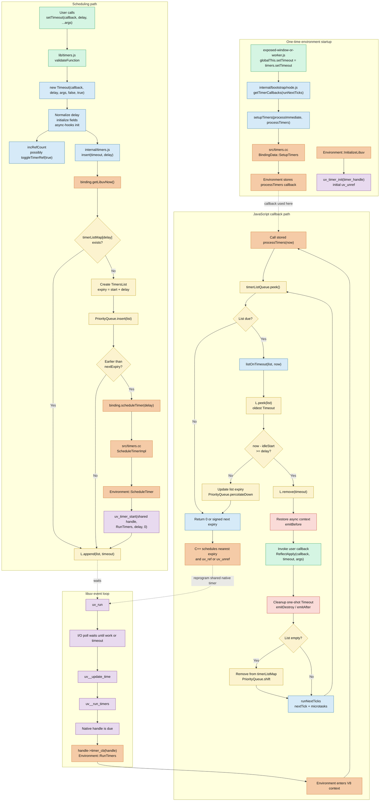

The complete `setTimeout()` path is:

```text
globalThis.setTimeout
  → lib/timers.js:setTimeout()
  → new internal/timers.js:Timeout()
  → internal/timers.js:insert()
  → TimersList + linked list + priority queue
  → internalBinding('timers').scheduleTimer()
  → src/timers.cc
  → Environment::ScheduleTimer()
  → uv_timer_start()
  → libuv event loop waits
  → Environment::RunTimers()
  → internal/timers.js:processTimers()
  → listOnTimeout()
  → async-hooks before
  → user callback
  → cleanup + async-hooks destroy/after
  → schedule the next nearest timer
```

The most important architectural insight is:

> Node does not create a separate native `uv_timer_t` for every JavaScript `Timeout`. Each Node `Environment` has one native timer handle. JavaScript groups and orders all individual timers, then programs that native handle for the nearest expiry.

Each Worker has its own `Environment`, and therefore its own timer handle and JavaScript timer queues.

## 1. One-time startup wiring

This happens during Node startup, not every time you call `setTimeout()`.

### Exposing the global function

[exposed-window-or-worker.js](/home/ibrahim/src/node/lib/internal/bootstrap/web/exposed-window-or-worker.js:31) loads the public `timers` module:

```js
const timers = require('timers');

defineOperation(globalThis, 'clearInterval', timers.clearInterval);
defineOperation(globalThis, 'clearTimeout', timers.clearTimeout);
defineOperation(globalThis, 'setInterval', timers.setInterval);
defineOperation(globalThis, 'setTimeout', timers.setTimeout);
```

Therefore these refer to the same implementation:

```js
globalThis.setTimeout
require('timers').setTimeout
```

### Registering the callback from C++ into JavaScript

During bootstrap, [node.js](/home/ibrahim/src/node/lib/internal/bootstrap/node.js:359) creates the JavaScript timer-processing functions:

```js
const { nextTick, runNextTicks } = setupTaskQueue();

const { setupTimers } = internalBinding('timers');

const {
  processImmediate,
  processTimers,
} = internalTimers.getTimerCallbacks(runNextTicks);

setupTimers(processImmediate, processTimers);
```

`setupTimers()` crosses into [src/timers.cc](/home/ibrahim/src/node/src/timers.cc:24):

```cpp
env->set_immediate_callback_function(args[0].As<Function>());
env->set_timers_callback_function(args[1].As<Function>());
```

This stores `processTimers` inside the current `Environment`. Later, libuv calls C++, and C++ calls this stored JavaScript function.

### Creating the one native timer

During environment initialization, [env.cc](/home/ibrahim/src/node/src/env.cc:1314) runs:

```cpp
uv_timer_init(event_loop(), timer_handle());
uv_unref(reinterpret_cast<uv_handle_t*>(timer_handle()));
```

The handle is stored on `Environment` as:

```cpp
uv_timer_t timer_handle_;
```

in [env.h](/home/ibrahim/src/node/src/env.h:1239).

It begins unreferenced, so an empty timer subsystem does not keep Node alive.

---

## 2. Calling `setTimeout()`

Given:

```js
const timer = setTimeout(callback, 1000, 'hello');
```

execution enters [timers.js](/home/ibrahim/src/node/lib/timers.js:123):

```js
function setTimeout(callback, after, ...args) {
  validateFunction(callback, 'callback');

  const timeout = new Timeout(
    callback,
    after,
    args.length ? args : undefined,
    false,
    true,
  );

  insert(timeout, timeout._idleTimeout);
  return timeout;
}
```

The arguments passed to `Timeout` mean:

| Argument | Value | Meaning |
|---|---:|---|
| `callback` | function | Function to execute |
| `after` | `1000` | Requested delay |
| `args` | `['hello']` | Callback arguments |
| `isRepeat` | `false` | This is not an interval |
| `isRefed` | `true` | It keeps the process alive |

`setTimeout()` immediately returns a `Timeout` object. It does not wait or execute the callback itself.

---

## 3. Constructing the `Timeout`

The constructor is in [internal/timers.js](/home/ibrahim/src/node/lib/internal/timers.js:208).

### Delay normalization

```js
if (after === undefined) {
  after = 1;
} else {
  after *= 1;
}
```

Then Node checks:

```js
if (!(after >= 1 && after <= TIMEOUT_MAX)) {
  // Possibly emit warning.
  after = 1;
}
```

`TIMEOUT_MAX` is:

```js
2 ** 31 - 1
```

Therefore:

| Input | Internal delay |
|---|---:|
| `undefined` | 1 ms |
| `0` | 1 ms |
| Negative number | 1 ms, warning once |
| `NaN` | 1 ms, warning once |
| Greater than `2³¹ - 1` | 1 ms, overflow warning |
| Numeric string such as `"100"` | 100 ms |

This means `setTimeout(callback, 0)` still schedules asynchronously with an internal delay of 1 ms.

### Object fields

The constructor creates fields such as:

```js
this._idleTimeout = after;
this._idleStart = null;
this._onTimeout = callback;
this._timerArgs = args;
this._repeat = null;
this._destroyed = false;
```

It also creates:

```js
this._idlePrev
this._idleNext
```

These fields let the `Timeout` object participate directly in an intrusive linked list.

### Reference counting

Because normal `setTimeout()` passes `isRefed = true`:

```js
incRefCount();
```

When the first referenced timeout is created:

```js
binding.toggleTimerRef(true);
```

This crosses through [timers.cc](/home/ibrahim/src/node/src/timers.cc:65) to:

```cpp
Environment::ToggleTimerRef(true)
```

which calls `uv_ref()` in [env.cc](/home/ibrahim/src/node/src/env.cc:1752). This makes the environment’s shared native timer keep the process alive.

### Async-hooks initialization

The constructor calls:

```js
initAsyncResource(this, 'Timeout');
```

That operation:

1. Allocates an async ID.
2. Captures the trigger async ID.
3. Captures the current async context.
4. Emits the async-hooks `init` event, if hooks are enabled.

---

## 4. Inserting the timeout

After construction, `setTimeout()` calls [insert()](/home/ibrahim/src/node/lib/internal/timers.js:419):

```js
insert(timeout, timeout._idleTimeout);
```

### Obtain libuv time

The default `start` value comes from:

```js
binding.getLibuvNow()
```

The binding enters [src/timers.cc](/home/ibrahim/src/node/src/timers.cc:33), which obtains the environment’s monotonic libuv time.

Node timers use monotonic event-loop time, not wall-clock `Date.now()`. System clock adjustments therefore do not directly move an already scheduled timer.

### Group by delay

Node maintains:

```js
const timerListMap = { __proto__: null };
```

The key is the timer duration:

```text
timerListMap[1000] → all timers created with a 1000 ms delay
timerListMap[5000] → all timers created with a 5000 ms delay
```

This is grouping by duration, not absolute expiry.

If the list does not exist:

```js
const expiry = start + msecs;
list = new TimersList(expiry, msecs);
timerListMap[msecs] = list;
timerListQueue.insert(list);
```

### Two-level data structure

Node uses two data structures:

```text
PriorityQueue
  ├── TimersList for 10 ms
  │     ├── Timeout A
  │     ├── Timeout B
  │     └── Timeout C
  │
  ├── TimersList for 100 ms
  │     └── Timeout D
  │
  └── TimersList for 1000 ms
        ├── Timeout E
        └── Timeout F
```

The priority queue contains timer lists, not every timeout.

- `timerListMap[msecs]` finds a same-duration list quickly.
- `timerListQueue` finds the earliest-expiring list.
- Each `TimersList` is a linked list ordered oldest to newest.

The linked-list operations are in [linkedlist.js](/home/ibrahim/src/node/lib/internal/linkedlist.js:9):

- `append(list, item)`
- `peek(list)`
- `remove(item)`
- `isEmpty(list)`

The binary heap is implemented in [priority_queue.js](/home/ibrahim/src/node/lib/internal/priority_queue.js:9).

### Append the individual timeout

Finally:

```js
L.append(list, item);
```

New timers go at the newest end. `L.peek(list)` retrieves the oldest timer, which is the next candidate to expire.

---

## 5. Programming the native timer

If the newly created `TimersList` expires before the currently programmed expiry:

```js
if (nextExpiry > expiry) {
  binding.scheduleTimer(msecs);
  nextExpiry = expiry;
}
```

The crossing is:

```text
internal/timers.js
  binding.scheduleTimer(msecs)
        ↓
src/timers.cc
  FastScheduleTimer() or SlowScheduleTimer()
        ↓
  ScheduleTimerImpl()
        ↓
src/env.cc
  Environment::ScheduleTimer()
        ↓
libuv
  uv_timer_start()
```

[Environment::ScheduleTimer()](/home/ibrahim/src/node/src/env.cc:1747) does:

```cpp
uv_timer_start(timer_handle(), RunTimers, duration_ms, 0);
```

Parameters:

| Parameter | Meaning |
|---|---|
| `timer_handle()` | Shared per-environment timer |
| `RunTimers` | Native callback when it expires |
| `duration_ms` | Delay until nearest list |
| `0` | Native timer does not automatically repeat |

Calling `uv_timer_start()` again replaces the existing schedule for that shared handle.

The libuv implementation is in [deps/uv/src/timer.c](/home/ibrahim/src/node/deps/uv/src/timer.c:67). It:

1. Stops the timer if already active.
2. Calculates its absolute expiry.
3. Stores `RunTimers` as `timer_cb`.
4. Inserts the native handle into libuv’s native timer heap.
5. Marks the handle active.

There are therefore two different heaps involved:

```text
Node JavaScript PriorityQueue
    Orders TimersList objects belonging to this Environment

libuv native timer heap
    Orders uv_timer_t handles belonging to the entire uv_loop
```

Node contributes only one `uv_timer_t` for ordinary JavaScript timeouts in each `Environment`.

---

## 6. Waiting in the event loop

The Unix event-loop implementation is in [deps/uv/src/unix/core.c](/home/ibrahim/src/node/deps/uv/src/unix/core.c:427).

A simplified loop is:

```text
pending callbacks
    ↓
idle/prepare
    ↓
I/O poll
    ↓
check phase
    ↓
closing callbacks
    ↓
update loop time
    ↓
run due timers
```

When the native timer becomes due, [uv__run_timers()](/home/ibrahim/src/node/deps/uv/src/timer.c:164):

1. Looks at the minimum native timer.
2. Checks whether it is due.
3. Removes it from the libuv heap.
4. Calls its stored callback:

```cpp
handle->timer_cb(handle);
```

For Node’s shared timer handle, that callback is:

```cpp
Environment::RunTimers
```

A timeout is not a guarantee that the callback runs at the exact requested time. It becomes eligible after the delay; busy JavaScript, I/O callbacks, OS scheduling, or other work can make it run later.

---

## 7. Returning from libuv into Node

[Environment::RunTimers()](/home/ibrahim/src/node/src/env.cc:1762):

1. Recovers the `Environment` from the `uv_timer_t`.
2. Enters the correct V8 isolate and context.
3. Creates an `InternalCallbackScope`.
4. Gets the stored JavaScript `processTimers` function.
5. Gets the current environment time.
6. Calls `processTimers(now)`.

The important call is:

```cpp
ret = cb->Call(env->context(), process, 1, &arg);
```

Here, `cb` is the JavaScript `processTimers` function installed during bootstrap.

---

## 8. Processing expired timer lists

`processTimers(now)` is in [internal/timers.js](/home/ibrahim/src/node/lib/internal/timers.js:596):

```js
function processTimers(now) {
  nextExpiry = Infinity;

  while ((list = timerListQueue.peek()) != null) {
    if (list.expiry > now) {
      nextExpiry = list.expiry;
      return timeoutInfo[0] > 0 ? nextExpiry : -nextExpiry;
    }

    runNextTicks(); // Between lists, when applicable.
    listOnTimeout(list, now);
  }

  return 0;
}
```

It repeatedly inspects the earliest `TimersList`.

There are two possibilities:

```text
list.expiry <= now
    → Process this list with listOnTimeout()

list.expiry > now
    → Stop and return the next expiry to C++
```

---

## 9. Processing individual timeouts

[listOnTimeout()](/home/ibrahim/src/node/lib/internal/timers.js:616) processes the oldest timeout:

```js
timer = L.peek(list);
```

It calculates how long that particular timer has waited:

```js
const diff = now - timer._idleStart;
```

### If the timer is not ready

This can occur because multiple timers with the same delay were appended at different times.

```js
if (diff < msecs) {
  list.expiry = MathMax(timer._idleStart + msecs, now + 1);
  list.id = timerListId++;
  timerListQueue.percolateDown(1);
  return;
}
```

The list receives its next correct expiry and moves down the priority queue.

### If the timer is ready

It is removed before executing its callback:

```js
L.remove(timer);
```

Then Node restores the timer’s captured async context and emits:

```js
emitBefore(asyncId, triggerAsyncId, timer);
```

The callback runs:

```js
const args = timer._timerArgs;

if (args === undefined)
  timer._onTimeout();
else
  ReflectApply(timer._onTimeout, timer, args);
```

For:

```js
setTimeout(callback, 1000, 'hello', 42);
```

this is conceptually:

```js
callback.call(timeoutObject, 'hello', 42);
```

Do not depend on the callback’s `this` value in application code; an arrow function is usually clearer.

### `nextTick` and microtasks

Between multiple due timer callbacks, `listOnTimeout()` invokes:

```js
runNextTicks();
```

[runNextTicks()](/home/ibrahim/src/node/lib/internal/process/task_queues.js:63) processes:

- V8 microtasks, including Promise reactions
- `process.nextTick()` callbacks
- Promise rejection handling

This is why `process.nextTick()` or Promise work created by one timeout can run before Node proceeds to another due timeout.

---

## 10. One-shot cleanup

For `setTimeout()`, `_repeat` is `null`, so it is not reinserted.

In the `finally` block, Node:

1. Marks the timer destroyed.
2. Removes captured async-context state.
3. Removes its numeric primitive ID, if created.
4. Decrements the referenced-timeout count.
5. Emits async-hooks `destroy`.
6. Eventually emits `after` and restores the prior async context.

When the final referenced timer disappears, reference counting ultimately causes:

```text
binding.toggleTimerRef(false)
  → Environment::ToggleTimerRef(false)
  → uv_unref(shared timer handle)
```

When a `TimersList` becomes empty:

```js
delete timerListMap[msecs];
timerListQueue.shift();
```

---

## 11. Selecting the next timeout

When `processTimers()` finishes, it returns one of three values:

| Return value | Meaning |
|---:|---|
| `0` | No timers remain |
| Positive expiry | Timers remain and at least one is referenced |
| Negative expiry | Timers remain, but all are unreferenced |

Back in [Environment::RunTimers()](/home/ibrahim/src/node/src/env.cc:1795), C++ calculates the next relative delay:

```cpp
duration_ms =
  abs(expiry_ms) -
  (uv_now(event_loop) - timer_base);
```

Then:

```cpp
ScheduleTimer(duration_ms > 0 ? duration_ms : 1);
```

It also updates whether the shared native timer keeps Node alive:

```cpp
expiry_ms > 0 → uv_ref(handle)
expiry_ms < 0 → uv_unref(handle)
expiry_ms == 0 → uv_unref(handle)
```

The cycle repeats for the next nearest expiry.

---

## 12. `clearTimeout()`, `unref()`, `ref()`, and `refresh()`

These are useful side branches for your diagram.

### `clearTimeout(timer)`

[clearTimeout()](/home/ibrahim/src/node/lib/timers.js:144):

```text
clearTimeout(timer)
  → timer._onTimeout = null
  → unenroll(timer)
  → emitDestroy()
  → L.remove(timer)
  → possibly remove empty TimersList
  → decrement referenced-timeout count
  → clean timer fields
```

Clearing one JavaScript timer usually does not call `uv_timer_stop()` directly. The shared native timer may wake at its existing programmed time, after which Node computes the next valid expiry.

### `timer.unref()`

```text
Timeout.unref()
  → mark Timeout unreferenced
  → decRefCount()
  → if global referenced count reaches zero
       binding.toggleTimerRef(false)
       → uv_unref(shared handle)
```

The timeout remains scheduled, but it no longer keeps the process alive.

### `timer.ref()`

Reverses `unref()`:

```text
Timeout.ref()
  → incRefCount()
  → possibly uv_ref(shared handle)
```

### `timer.refresh()`

```text
Timeout.refresh()
  → active() or unrefActive()
  → insertGuarded()
  → insert()
```

It updates the start time and reinserts the same `Timeout`, avoiding a new object allocation.

---

# Draw.io-ready master diagram

In draw.io, use its Mermaid insertion feature and paste this:



Recommended draw.io colors:

- Green: public API/user code
- Blue: internal JavaScript
- Yellow: JavaScript data structures
- Orange: Node C++
- Purple: libuv
- Red: async hooks and cleanup

## Best source-reading order

Follow these files in this order:

1. [lib/timers.js](/home/ibrahim/src/node/lib/timers.js:123) — public API
2. [lib/internal/timers.js](/home/ibrahim/src/node/lib/internal/timers.js:208) — `Timeout`
3. [lib/internal/timers.js](/home/ibrahim/src/node/lib/internal/timers.js:419) — insertion
4. [lib/internal/linkedlist.js](/home/ibrahim/src/node/lib/internal/linkedlist.js:9) — same-delay lists
5. [lib/internal/priority_queue.js](/home/ibrahim/src/node/lib/internal/priority_queue.js:22) — list ordering
6. [src/timers.cc](/home/ibrahim/src/node/src/timers.cc:24) — JS/C++ bridge
7. [src/env.cc](/home/ibrahim/src/node/src/env.cc:1747) — native scheduling
8. [deps/uv/src/timer.c](/home/ibrahim/src/node/deps/uv/src/timer.c:67) — libuv timer
9. [deps/uv/src/unix/core.c](/home/ibrahim/src/node/deps/uv/src/unix/core.c:427) — event loop
10. [lib/internal/timers.js](/home/ibrahim/src/node/lib/internal/timers.js:596) — return to JavaScript
11. [lib/internal/process/task_queues.js](/home/ibrahim/src/node/lib/internal/process/task_queues.js:63) — ticks and microtasks

You can observe the JavaScript-side behavior with your local build:

```bash
NODE_DEBUG=timer ./node -e "
const timer = setTimeout(
  (value) => console.log('callback:', value),
  100,
  'payload'
);
console.log('created:', timer.constructor.name, timer.hasRef());
"
```

The trace will show list creation, timer-list processing, callback execution, and list removal.